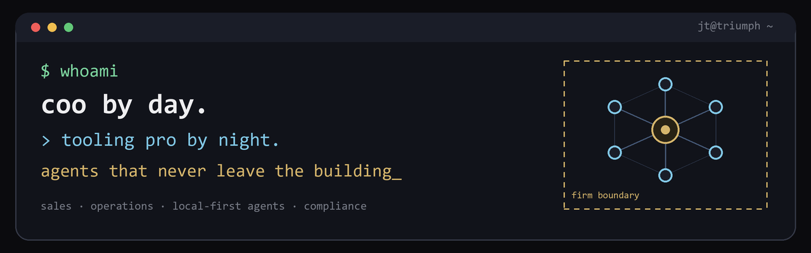

  

  

<h1 align="center">Jeffrey Thomas</h1>

<b>I build agentic tools that work inside a firm's walls: local-first, secure, and built to ship.</b>

Sales · Operations · Local-first agent infrastructure · Creative tools

  
  
  

---

### 👋 About me

Chief Operating Officer at **Triumph Capital Management**, an SEC-registered advisory firm. I live where sales, operations and agentic tooling converge, and I'm a tooling pro at heart: if a workflow repeats, I'm already building the thing that runs it.

My favorite problem right now: agents that do real work **without leaving the building**. They run on firm machines, read firm systems through read-only connectors, and hand people finished work instead of another tab to check.

- 🤝 **Sales first.** Tools that help advisors prep, pitch and follow up faster.
- ⚙️ **Operations on autopilot.** If it happens every morning, it's scheduled, logged and checked before anyone logs in.
- 🏠 **Local-first.** Data stays inside the firm's boundary. Code ships, records stay put.

### 🚀 What I build

<table>
<tr>
<td width="50%" valign="top">

**🧭 Advisor Portal** 
One home for advisors: households, accounts, action items and client intake. 
<code>Next.js</code> <code>TypeScript</code> <code>Supabase</code> · <a href="https://tcm.calyxion.com">tcm.calyxion.com</a>

</td>
<td width="50%" valign="top">

**🎯 Fusion Builder** 
Turns a pitch, meeting or client call into a structured plan, then rates the draft before it goes out. 
<code>Python</code> <code>local app</code>

</td>
</tr>
<tr>
<td valign="top">

**🤖 In-Boundary Agents** 
Agent workflows that run locally, read custodian and CRM data through read-only connectors, and never ship data out. 
<code>Python</code> <code>MCP</code> <code>Doppler</code>

</td>
<td valign="top">

**🧰 Workbench** 
My command center: hot list, apps, outputs, notes and live status of every scheduled job. 
<code>Python</code> <code>HTML</code>

</td>
</tr>
<tr>
<td valign="top">

**🔗 Custodian Data Pipelines** 
Black Diamond and Schwab feeds landing in a warehouse every morning, orchestrated and verified. 
<code>Python</code> <code>PowerShell</code> <code>Postgres</code>

</td>
<td valign="top">

**📈 Market & Options Reports** 
Daily market briefs and options activity reports, enriched with live market data. 
<code>Python</code> <code>REST APIs</code>

</td>
</tr>
<tr>
<td valign="top">

**🏗️ CapForge** 
Formation, cap tables, entity structure and equity modeling in one app. 
<code>TypeScript</code> <code>React</code>

</td>
<td valign="top">

**🛡️ Compliance Automation** 
Recurring reviews and audits rebuilt as repeatable pipelines. 
<code>Python</code> <code>pandas</code> <code>Box</code>

</td>
</tr>
</table>

Most of this lives in private repositories, because firm systems stay private.

### ⚙️ Stack

  
  
  
  
  
  
  
  
  
  
  

---

coo by day · tooling pro by night · shipping daily

